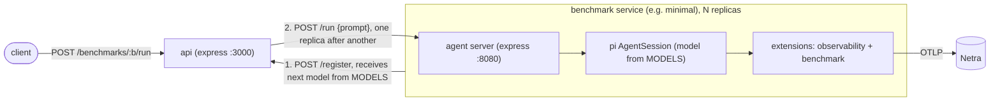

# benchmark-harness

A benchmarking system built on [pi](https://pi.dev) agents. Each benchmark is a Docker image containing a pi agent with two extensions: `observability` (Netra tracing) and a benchmark-specific one (tools and skills for that benchmark). One replica runs per model config, and an API triggers runs across them.

## How it works



- **Replicas = models.** `MODELS` (a JSON list in `.env`) holds the model configs. `npm run up` scales each benchmark service to one replica per model.
- **Registration.** On startup a replica registers with the API and is assigned the next unassigned model for its benchmark. Only the API sees `MODELS`; model API keys never enter agent container environments.
- **Sessions.** The agent writes a temporary `models.json` for its model and builds an in-memory pi session. `POST /run` starts a prompt in the background (202) and `GET /state` reports `idle | running | done | error`.
- **Extensions.** Each subdirectory of `./extensions` in the container is loaded as one pi extension. Observability is exported to Netra; results are viewed there.

## Quick start

1. `cp .env.example .env` and fill in:
   - `MODELS`: JSON list of `{ name, baseUrl, apiKey, api, modelId, thinkingLevel? }` (`api` e.g. `openai-completions`, `anthropic-messages`).
   - `NETRA_OTLP_ENDPOINT`, `NETRA_API_KEY` (shared by all agents; tracing is skipped if the endpoint is unset). Optional `NETRA_ENV`, `NETRA_DEBUG`.
2. `npm run up -- minimal` builds and starts the API plus one `minimal` replica per model. Pass several benchmark names to start several.
3. Trigger a run:
   ```sh
   curl -X POST localhost:3000/benchmarks/minimal/run \
     -H 'content-type: application/json' \
     -d '{"prompt": "Say hi in one sentence.", "models": ["model-name"]}'   # omit "models" for all
   ```
4. Watch progress: `curl localhost:3000/benchmarks/minimal/status`.

## API

| Route | Purpose |
|---|---|
| `POST /register` | Used by replicas: `{benchmark, url}` → `{model}` |
| `GET /benchmarks` | Registered replicas per benchmark (API keys redacted) |
| `POST /benchmarks/:benchmark/run` | `{prompt, models?}`; dispatches sequentially, returns a status per model (`202`, or `409` if that replica is busy) |
| `GET /benchmarks/:benchmark/status` | State of each replica |

## Adding a benchmark

1. Create the benchmark extension in `src/extensions/<benchmark>/index.ts` (tools and skills).
2. Add `docker/Dockerfile.<benchmark>`, copied from `Dockerfile.minimal`: `COPY` both `observability` and `<benchmark>` into `./extensions`, and set `ENV NETRA_APP_NAME=<benchmark>` (the agent name in Netra).
3. Add a service to `docker-compose.yml` like `minimal` (with `<<: *netra` and `BENCHMARK: <benchmark>`).
4. `npm run up -- <benchmark>`.

## Development

Everything runs through Docker Compose; images contain the code (no bind mounts), so rebuild after changes (`npm run up` does `--build`).

- Typecheck: `docker compose run --rm --entrypoint npm minimal run typecheck` (or `npx tsc` locally).
- Debug a single agent over stdio RPC (no API): `echo '{"id":"1","type":"get_state"}' | docker compose run --rm -T --entrypoint node minimal --experimental-strip-types src/agent/index.ts`.

## Layout

| Path | What |
|---|---|
| `src/agent/` | `server.ts` (container entrypoint), `config.ts` (session builder), `index.ts` (stdio RPC entry for debugging) |
| `src/api/` | express API and replica registry |
| `src/shared/` | types shared by agent and API |
| `src/extensions/` | one directory per pi extension (`observability`, benchmarks) |
| `docker/` | `Dockerfile.api` and one `Dockerfile.<benchmark>` each |
