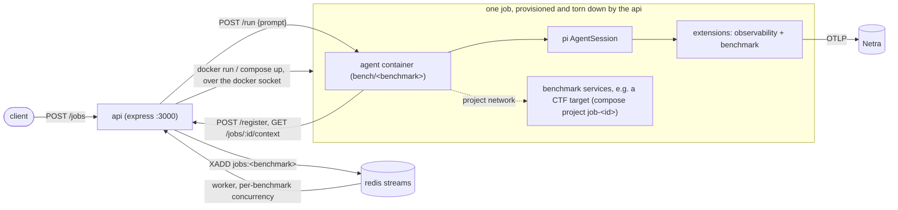

# benchmark-harness

A benchmarking system built on [pi](https://pi.dev) agents. Each benchmark is a Docker image containing a pi agent with two extensions: `observability` (Netra tracing) and a benchmark-specific one (tools and skills for that benchmark). An API queues jobs (one per benchmark input and model) and provisions a fresh agent container, plus whatever else the benchmark needs, for each job.

## How it works



- **Jobs.** `POST /jobs` creates one job per selected model (and per challenge, for benchmarks that have them) and adds each to the benchmark's Redis stream (`jobs:<benchmark>`). A worker per benchmark reads it with a consumer group and runs at most `CONCURRENCY_<BENCHMARK>` jobs at once. Entries are acked when the job settles; jobs left pending by a crashed API are re-run on startup after leftover containers are swept.
- **Benchmarks** (`src/api/benchmarks/`). Each benchmark has a handler that validates the request (`parse`), optionally serves context to the agent (`context`) and runs the job (`run`), owning everything it provisions: `minimal` is a bare agent; `cyber` also brings up the challenge's compose project and joins the agent to its network, and removes both afterwards.
- **Agents.** The API runs `bench/<benchmark>` containers on the `bench` network via the docker socket (only the API has it). The agent registers with `POST /register {jobId}` and receives its model config; model API keys never enter agent container environments or `docker inspect`. `POST /run` starts the prompt (202); `GET /state` reports `idle | running | done | error`. Set `MAX_TURNS` to abort runs that exceed that many model turns.
- **Extensions.** Each subdirectory of `./extensions` in the container is loaded as one pi extension. Observability is exported to Netra; results are viewed there. Benchmarks emit `benchmark_context` and `benchmark_result` events on the pi event bus, which observability records as spans.

### Cyber benchmark

Challenges live in `resources/cyber/challenges/<id>/`:

| Path | What |
|---|---|
| `challenge.json` | `{name, source, prompt, flag, target}` |
| `files/` | copied into the agent at `/ctf/files` |
| `target/compose.yml` | the challenge's services (optional); no `container_name`, published ports or external networks, so jobs never collide. The agent reaches the target by name on the job's project network |

- At startup the cyber extension fetches `GET /jobs/:id/context` (served once per run), emits `benchmark_context` with the flag and metadata, and registers a `submit_flag` tool. Submitting emits `benchmark_result {correct, ...}` and ends the run; a run that ends without a submission emits `submitted: false`.
- `scripts/import-cybench.ts` imports [Cybench](https://github.com/andyzorigin/cybench) challenges: `node --experimental-strip-types scripts/import-cybench.ts <cybench-checkout> [--only <id>] [--force]`. It prints what needs manual attention. Existing challenges are skipped unless `--force`.

## Quick start

1. `cp .env.example .env` and fill in:
   - `MODELS`: JSON list of `{ name, baseUrl, apiKey, api, modelId, thinkingLevel? }` (`api` e.g. `openai-completions`, `anthropic-messages`).
   - `NETRA_OTLP_ENDPOINT`, `NETRA_API_KEY` (shared by all agents; tracing is skipped if the endpoint is unset). Optional `NETRA_ENV`, `NETRA_DEBUG`.
   - Optional `MAX_TURNS` (model turns per run; empty or `0` is unlimited).
2. `npm run up` builds the benchmark images and starts the API and Redis (`bench/cyber` is large because it installs Kali tooling). Runs spend real model credits.
3. Queue jobs:
   ```sh
   curl -X POST localhost:3000/jobs -H 'content-type: application/json' \
     -d '{"benchmark": "minimal", "prompt": "Say hi in one sentence.", "models": ["model-name"]}'   # omit "models" for all
   curl -X POST localhost:3000/jobs -H 'content-type: application/json' \
     -d '{"benchmark": "cyber", "challenge": "labyrinth-linguist"}'                                  # or "all"
   ```
4. Watch progress: `curl localhost:3000/jobs/<id>`, or `curl localhost:3000/jobs` for all jobs.

## API

| Route | Purpose |
|---|---|
| `POST /jobs` | `{benchmark, models?, ...}` (`minimal`: `prompt`; `cyber`: `challenge` or `"all"`); creates a job per model (and challenge) and returns them (`202`) |
| `GET /jobs`, `GET /jobs/:id` | Job status: `queued → provisioning → running → done \| error \| cancelled` |
| `POST /jobs/:id/cancel` | Cancels a queued or running job |
| `POST /register` | Used by agents: `{jobId}` → `{model}` |
| `GET /jobs/:id/context` | Used by agents: the benchmark's context for the job, served once per run |

Environment: `CONCURRENCY_<BENCHMARK>` (jobs at once), `JOB_TIMEOUT_MS` (default 30 min), `MAX_TURNS`.

## Adding a benchmark

1. Create the benchmark extension in `src/extensions/<benchmark>/index.ts` (tools and skills).
2. Add `docker/Dockerfile.<benchmark>`, copied from `Dockerfile.minimal`: `COPY` both `observability` and `<benchmark>` into `./extensions`, and set `ENV NETRA_APP_NAME=<benchmark>` (the agent name in Netra).
3. Add an image-only service to `docker-compose.yml` like `minimal` (`image: bench/<benchmark>`, `profiles: ["agents"]`) so `npm run up` builds it.
4. Add a handler in `src/api/benchmarks/<benchmark>.ts` (see `minimal.ts` and `cyber.ts`) and register it in `src/api/benchmarks/index.ts`.

## Development

Everything runs through Docker Compose; images contain the code (no bind mounts), so rebuild after changes (`npm run up` does `--build`).

- Typecheck: `npx tsc` (`npm run typecheck`).
- Debug a single agent over stdio RPC (no API): `echo '{"id":"1","type":"get_state"}' | docker compose run --rm -T --entrypoint node minimal --experimental-strip-types src/agent/index.ts`.
- The API mounts `resources/` at the same absolute path as on the host (`${PWD}/resources`) because challenge compose projects run against the host's docker daemon, so run compose from the repo root.

## Layout

| Path | What |
|---|---|
| `src/agent/` | `server.ts` (container entrypoint), `config.ts` (session builder), `index.ts` (stdio RPC entry for debugging) |
| `src/api/` | `index.ts` (boot), `runner.ts` (runs one job), `benchmarks/` (per-benchmark handlers), `queue/` (Redis streams and job store), `docker/` (container provisioning), `routes/` |
| `src/shared/` | types shared by agent and API |
| `src/extensions/` | one directory per pi extension (`observability`, benchmarks) |
| `resources/cyber/` | cyber challenges |
| `scripts/` | `import-cybench.ts` |
| `docker/` | `Dockerfile.api` and one `Dockerfile.<benchmark>` each |
